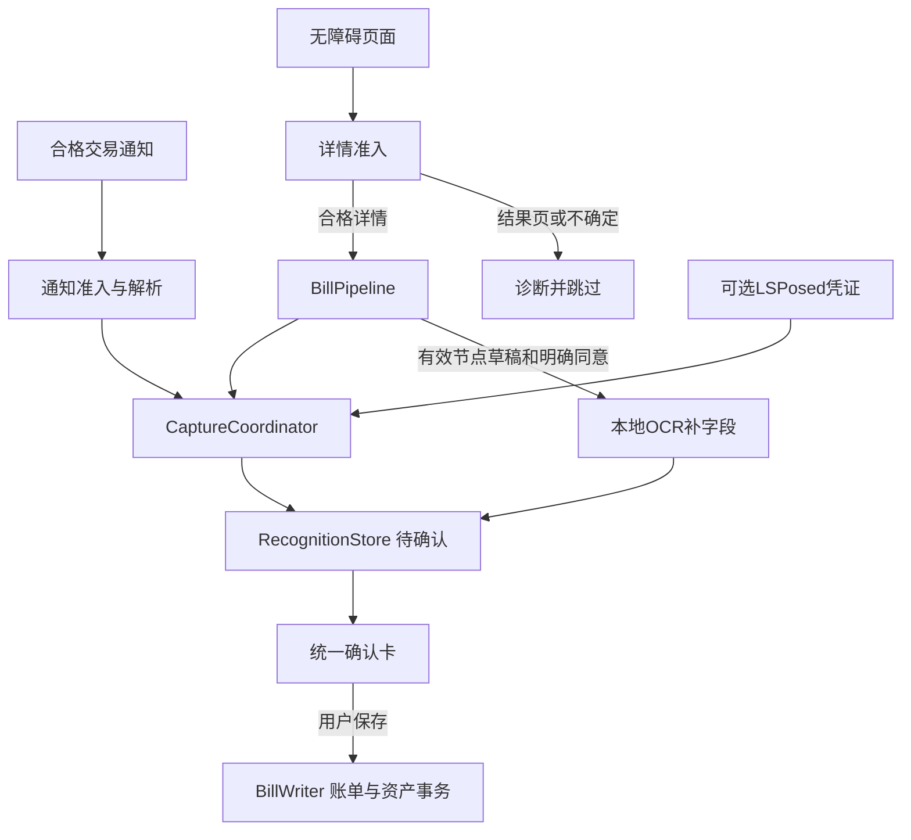
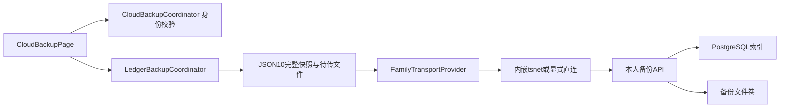
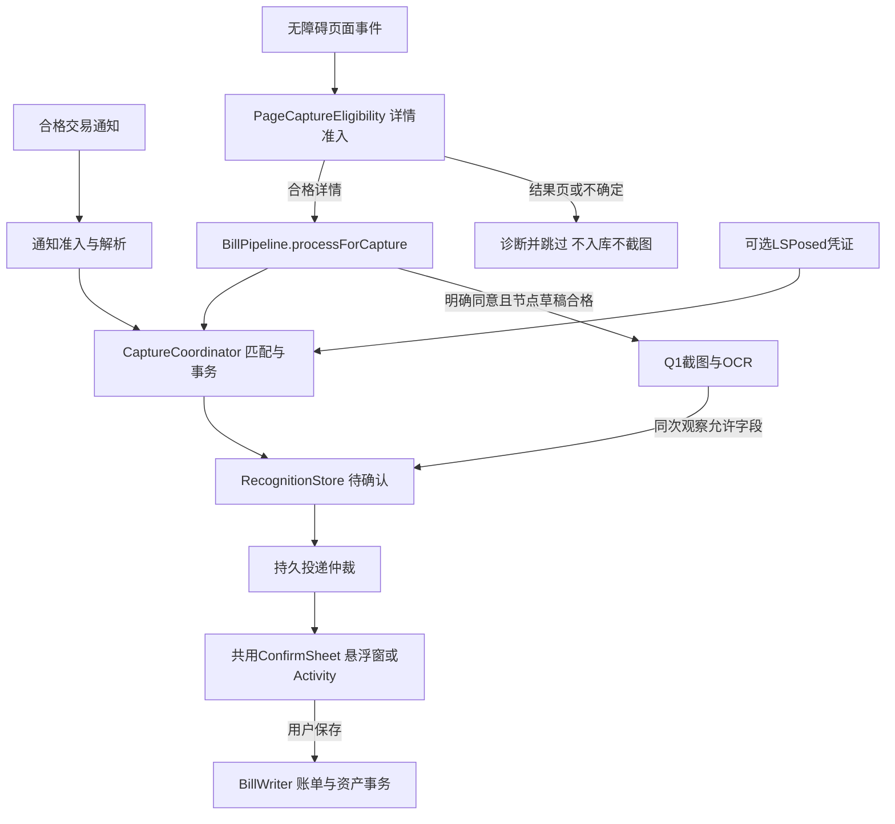

# 架构说明

<!-- acceptance-158-20261107 -->
> **当前版本1.10.0/158，用户验收通过（2026-11-07）**。用户确认现有交付通过，淘宝闪购订单抓取／实时验证继续作为后续工作。管理台、扫码连接、备份删除及历史恢复改进已纳入本次版本验收。工程覆盖按已有证据登记。验收详见[ACCEPTANCE](docs/ACCEPTANCE.md)，淘宝后续见[实时验证交接](docs/SHANGOU_LIVE_VALIDATION_HANDOFF.md)。以下历轮版本、待验收和测试描述按原日期理解。
<!-- /acceptance-158-20261107 -->

## 历史155进度复核（2026-11-06，仅文档）

> 历史版本快照（原日期口径） 当前候选 **1.9.0/155，Room11/JSON10，pending_acceptance**。删除历史、更多下移右对齐、context请求精简和Go HTTP复用主体已实现；155尚无用户验收。154返回修复/原“更多正常显示”分项通过保留。

本轮复核候选SHA五项通过，现存JVM XML为1180/0/0/0；服务端76 pytest、部署镜像155和Mi10显式直连实测引用原记录，未重跑/操作在线环境。已有实机证据是单选删除，批删能力不等于真实多选已测；内嵌通道和分段耗时未闭环，HTTP请求减少不等于连接慢已解决。

静态待收尾：R1删除重试未保留operationId；R2删后分页仍用旧offset；R3文件已不在时回收状态不能收尾；R4新备份未失效context缓存。详见[实现复核与后续](runs/20261106-181513-155-progress-review/outputs/implementation-review.md)。本轮只同步文档，不改源码/APK/旧证据，不操作手机或服务。

> 历史版本快照（原日期口径） 当前源码/候选 **1.9.0/155，Room11/JSON10**，`pending_acceptance`。153实现个人云备份；154仅修云备份返回层级。小米14已按用户授权先后安装153和154（ADB安装Success），安装后未代打开App或操作验证；随后用户已明确验收154返回修复并确认“更多”正常显示，不扩大到155新功能。当前范围和验收见[项目范围](docs/PROJECT_SCOPE.md)、[进度](docs/PROGRESS.md)与[验收](docs/ACCEPTANCE.md)。

## 模块与本机记账

| 模块 | 职责 |
| --- | --- |
| `:app` | Compose、采集权限与投递、Room账本/资产、备份恢复、个人规则、内置LSPosed与OCR队列 |
| `:billkit` | 页面/通知准入和纯解析、字段/身份策略、Rhino交易规则；内部包名`com.example.billkit` |
| `:ocr-v6` | 固定离线V6 Tiny引擎；API/ABI门槛独立于App最低版本 |
| `:ocr-fixture` | 仅显式启用的合成页面模块，不进入生产App |
| `server/` | 私人备份服务、设备身份和受鉴权文件/索引；保留旧规则与ledger API兼容 |
| `transport/famisync/` | 正式内嵌tsnet桥接源码；Android通过`app/libs/famisync.aar`使用 |

通知与普通PAGE独立；Root dumpsys与NotificationListener是同一通知通道的备选实现，页面只有无障碍详情路径。付款结果页不经PAGE生成草稿/卡或截图。Q1仅补可靠节点草稿缺字段，不覆盖人工修改或已处理记录；Q2缺金额兜底未实现。主动截图补记已按用户要求取消，设置入口/Activity仍是未清退残留，不能作为新支持通道。

统一查重仍在卡内对账本提示，重复标签只提示不代用户保存。`BillWriter`串行化写入，事务后收集列表不再用跨协程ThreadLocal；旧ledger outbox代码和数据保留，但新云备份UI不触发逐条账本或共享规则同步。

## 个人云备份链路

安装UUID用于稳定登记，服务端`devices.id`是稳定备份来源；随机秘密凭证证明权限，UUID/名称/IP/网络节点不能当凭证。正常重连鉴权复用原来源；重装丢身份后，经短时连接码授权、明确接替、轮换凭证，保留历史来源。待登记秘密与操作先以Keystore加密持久化，回执丢失只重试原请求；身份不进入普通JSON备份。

管理页签发五分钟、一次安装有效的业务连接码；网络授权与业务码独立。列表、下载及重试修复都由服务端限定当前来源，不能同空间互读；文件校验/落盘和索引提交后才成功。失败保留待传快照，新版本不改写旧历史。云端恢复需下载校验、预览、二次确认及恢复前本地快照；本地文件恢复可离线。

154将主页、历史与连接管理纳入`SettingsScreen`统一路由栈，去除CloudBackupPage内部独立保存的子页字符串；系统返回与页面返回使用同一路径。本地文件入口按源码是云备份主页“更多→本地备份文件”；用户已明确验收返回修复并确认“更多”显示正常，结论来自用户；本地JSON实际导入/导出不因此通过。

## 存储与兼容

| 存储 | 当前作用 |
| --- | --- |
| `mymoney.db` / Room11 | 账单稳定`syncId`/更新时间/墓碑、识别历史、资产/流水、导入身份、只读删除日志等 |
| `rule-sync.db` | 本地规则权威及历史同步状态，云备份不要求首次规则合并 |
| `ledger-sync.db` | 旧逐条账本副本的outbox/状态，保留但退出当前备份主流程 |
| JSON10 | 完整账本快照，账单含`sid`；兼容旧格式读取，原始采集/设备凭证不移植 |
| SharedPreferences/Keystore | 本机配置及加密连接身份，按备份白名单隔离 |
| 服务端PG与文件卷 | 身份/授权/备份索引与不可变文件，需要联合备份 |

金额用Long整数分，恢复不等于重新扣款；备份不包含独立个人规则/官方包，规则另行导出。完整范围见[备份说明](docs/FAMILY_BACKUPS.md)。自动备份、扫码、有新改动指示、不可达旧服务器主动解绑尚未实现。旧M/W阶段表和API保留不等于仍开放对应产品入口。

## 验证边界

153 Mi10完成58笔备份→恢复→再备份，账单业务/sid/资产快照一致；身份仪器4项、内存恢复8项和服务端65项引用原run。154 JVM1175和三构建通过；小米14安装后用户明确验收154返回修复并确认“更多”正常显示。153/154云备份整体待验收，148原范围保留。本轮只同步文档，未重跑业务检查或代操作手机。

此前文档原文（历史状态，不作为当前操作指引）

## 用户验收结论（2026-11-06，优先于下方历史状态）

- **通过**：144再次确认；142重复提示精简、143标签间距；132统计下钻/记录历史/账单操作。
- **141分项**：交易详情自动识别通过；通知监听未继续深入优化，暂不通过。不得再把141整组写成待验收或整组通过。
- **138/139范围收敛后通过**：主动“从截图补记”功能取消，仅保留页面识别内部OCR辅助补字段；不新增并列采集通道。当前源码仍有SettingsScreen入口及OcrImportActivity声明，属于取消范围的残留，尚未清退；本次只同步文档，未改代码。
- **超级岛**：实验性功能，相关项目用户全部暂时验收通过；原“不出岛只出原卡”由用户确认是未授予通知权限，授权后正常，不再列为待定位/待用户验收。工程打包/装机摘要、源码提交与测试证据整理不因用户验收自动完成。
- **支付宝延时弹卡**：用户确认已修复，从历史遗留问题移除；本轮未定位修复提交或新增测试，不编造根因/验证数据。

未确认关闭的历史项：权限状态偶发过期、预测返回残影、整App流畅度全面结论；家庭同步failed按用户要求继续暂缓。OCR研究语料/预算、其他ROM/API/可访问性属于工程覆盖缺口，不重复要求用户验收已通过的功能。当前源码/本地Release输出146，候选指针仍145；不据此声明已发布。证据：`runs/20261106-110618-user-acceptance-sync/outputs/verification.md`。

# 架构说明

> J阶段145：账本查重只留统一卡；新访问模式不再调用旧会话provider或写盘。预留绑定持有草稿，过期仅释放自身，保留节流；采集等待参数不变。1105JVM/82Room/3实际卡回归；[验证](runs/20261105-193908-capture-cleanup/outputs/verification.md)，待用户验收。

> 2026-11-05 I阶段144：已知同笔的新详情访问也弹卡，独立确认轮次保留原账单与旧终态；重复标签仅查账本，不以识别历史判重复。同访问/活跃卡迟到字段不叠卡。1096JVM、82隔离Room、3合成实际卡、三构建/strict35；真机144已覆盖，真实应用验收待用户。最新[证据](runs/20261105-185800-repeat-confirmation/outputs/verification.md)。下方旧“终态不重弹”仅描述此前范围，现由I阶段覆盖。

当前已提交基线348ef48（145），K阶段工作区1.9.0/146未提交；正式候选仍145，Room10/JSON9；交付与验收边界见[项目范围](docs/PROJECT_SCOPE.md)。

## 模块与数据流

| 模块 | 职责 |
| --- | --- |
| :app | Compose、采集启停/权限、统一协调和投递、Room/备份、规则同步、内置LSPosed、OCR队列 |
| :billkit | 页面与通知的纯解析/准入/身份策略、字段抽取、Rhino交易规则、诊断；内部包名com.example.billkit |
| :ocr-v6 | 固定离线V6 Tiny引擎；主App依赖，API/ABI受门槛控制 |
| :ocr-fixture | 仅-PocrFixture=true包含的合成页面模块，不进生产App；可选两个目标包名，仅隔离测试环境 |

付款成功/结果页的页面路径不生成记录、不弹卡、不调用OCR，通知路径独立。Root dumpsys和NotificationListener是同一通知通道的两种实现，由可用性择一，不按普通/Root预设固定绑定。页面只有无障碍实现；Root页面轮询早已移除。没有手动“识别当前页”按钮。

## 页面准入与生命周期

PageCaptureEligibility区分DETAIL/PAYMENT_RESULT/OTHER/UNKNOWN；processForCapture在个人/外部规则之前拒绝非详情。BillKit.offer只走自动准入；只读BillPipeline.process可保留结果解析用于预览，不能由此授权实际入库。已知结果容器混入详情字段保守拒绝，成功词本身不能区分详情与结果。

BillAccessibilityService使用有界去抖和根重试，PageObservationScope保存有限临时观察；新事件、离开目标、配置/锁屏/断连使过期观察不可接受。App在接受/投递和OCR在采纳前再核对。服务为识别离开事件接收其他包窗口元数据，白名单外直接返回，不读其节点。已打开的自身确认卡不被无故撤销。

Q1只有节点已经建立可靠金额/方向的草稿，才可同次观察补空字段；截图不成为独立通道，不新增第二张卡，不覆盖人工字段或已处理记录。Q2缺金额兜底尚未实现。OCR需API30+、64位进程和支持ABI，默认关闭且明确同意；整页空节点盲截不在范围。

## 匹配、投递与保存

CaptureCoordinator先做事件/观察与强交易身份，再按已接受的固定60秒跨逻辑通道规则匹配；首次采集锚不续窗、明确不同交易身份分开。长时间后没有强身份，不能凭同额强行归并。

疑似重复对照账本时间±120000ms、金额和类型，用timeMillis索引+LIMIT200先收敛，再轻量账户比对。仅提示，保存决定交用户。同historyId重试幂等，用户确认的不同记录不再被旧10分钟指纹窗吞掉。

先合法落盘再尝试呈现；CLAIMED/ACKNOWLEDGED/UNKNOWN等区分已展示、可重试和回执不明。autoConfirm只控制自动弹卡，不是自动入账。系统UI与数据库不是同一事务，不承诺跨崩溃严格恰好一次。终态保护、编辑锁/版本核对保持；失败可从待确认继续。

## 存储和兼容

| 存储 | 当前作用 |
| --- | --- |
| mymoney.db / Room10 | 账单、识别历史、资产/流水、采集别名/证据/投递、导入身份、规则投影、只读删除日志等 |
| rule-sync.db | 本地规则权威、设备间同步队列和冲突；不用于逐笔账单双向同步 |
| SharedPreferences | mymoney保存启停与设备偏好；ledger_config等保存账本配置；不同配置按各自备份白名单处理 |
| JSON9 | 完整账本快照，兼容1–8；含删除日志，原始截图与运行授权不移植 |
| 私有规则包目录 | 活动/上一包及原子状态；App升级保留，交易ZIP另行保存 |

金额为Long整数分。只有用户保存后写账本和联动资产；删除原子处理关联账单并记录只读日志，不支持日志恢复。网络只服务更新及用户配置的家庭同步/备份，解析与OCR本地执行，原图不上传。

## 定位入口

app/capture下协调、无障碍和通知入口；app/data下Room与保存/备份；app/ocr下引擎/队列；app/ui下共用确认卡与页面。billkit中的PageClassifier.kt、AmountParser.kt、FieldExtractor.kt直接位于com/example/billkit目录，不在虚构page/amount/field子目录。更多见[测试环境](docs/TEST_ENVIRONMENT.md)、[OCR](docs/OCR_ASSISTANCE.md)与[验收](docs/ACCEPTANCE.md)。

