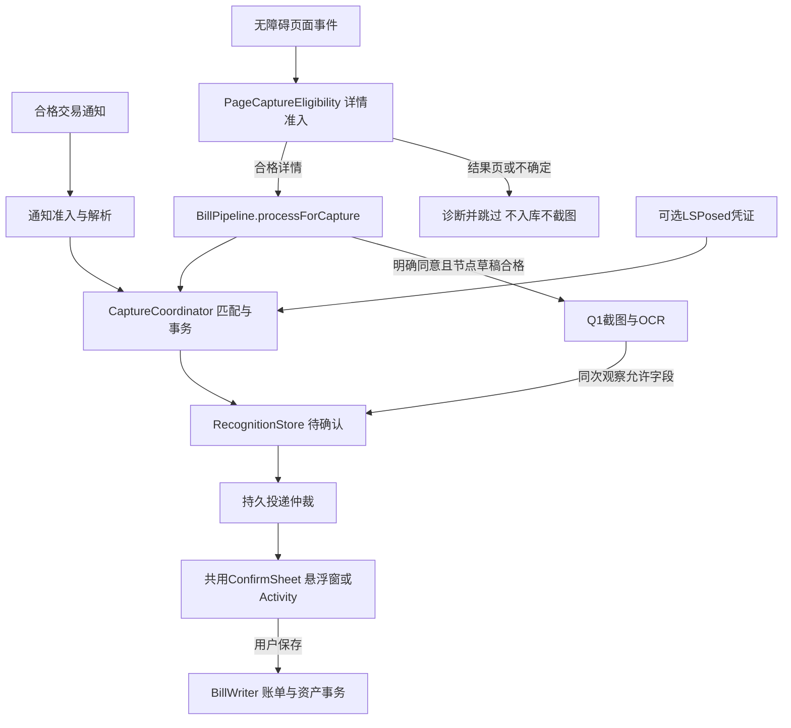

# 架构说明

> J阶段145：账本查重只留统一卡；新访问模式不再调用旧会话provider或写盘。预留绑定持有草稿，过期仅释放自身，保留节流；采集等待参数不变。1105JVM/82Room/3实际卡回归；[验证](runs/20261105-193908-capture-cleanup/outputs/verification.md)，待用户验收。

> 2026-11-05 I阶段144：已知同笔的新详情访问也弹卡，独立确认轮次保留原账单与旧终态；重复标签仅查账本，不以识别历史判重复。同访问/活跃卡迟到字段不叠卡。1096JVM、82隔离Room、3合成实际卡、三构建/strict35；真机144已覆盖，真实应用验收待用户。最新[证据](runs/20261105-185800-repeat-confirmation/outputs/verification.md)。下方旧“终态不重弹”仅描述此前范围，现由I阶段覆盖。

当前基线1.9.0/143，Room10/JSON9；交付与验收边界见[项目范围](docs/PROJECT_SCOPE.md)。

## 模块与数据流

| 模块 | 职责 |
| --- | --- |
| :app | Compose、采集启停/权限、统一协调和投递、Room/备份、规则同步、内置LSPosed、OCR队列 |
| :billkit | 页面与通知的纯解析/准入/身份策略、字段抽取、Rhino交易规则、诊断；内部包名com.example.billkit |
| :ocr-v6 | 固定离线V6 Tiny引擎；主App依赖，API/ABI受门槛控制 |
| :ocr-fixture | 仅-PocrFixture=true包含的合成页面模块，不进生产App；可选两个目标包名，仅隔离测试环境 |

付款成功/结果页的页面路径不生成记录、不弹卡、不调用OCR，通知路径独立。Root dumpsys和NotificationListener是同一通知通道的两种实现，由可用性择一，不按普通/Root预设固定绑定。页面只有无障碍实现；Root页面轮询早已移除。没有手动“识别当前页”按钮。

## 页面准入与生命周期

PageCaptureEligibility区分DETAIL/PAYMENT_RESULT/OTHER/UNKNOWN；processForCapture在个人/外部规则之前拒绝非详情。BillKit.offer只走自动准入；只读BillPipeline.process可保留结果解析用于预览，不能由此授权实际入库。已知结果容器混入详情字段保守拒绝，成功词本身不能区分详情与结果。

BillAccessibilityService使用有界去抖和根重试，PageObservationScope保存有限临时观察；新事件、离开目标、配置/锁屏/断连使过期观察不可接受。App在接受/投递和OCR在采纳前再核对。服务为识别离开事件接收其他包窗口元数据，白名单外直接返回，不读其节点。已打开的自身确认卡不被无故撤销。

Q1只有节点已经建立可靠金额/方向的草稿，才可同次观察补空字段；截图不成为独立通道，不新增第二张卡，不覆盖人工字段或已处理记录。Q2缺金额兜底尚未实现。OCR需API30+、64位进程和支持ABI，默认关闭且明确同意；整页空节点盲截不在范围。

## 匹配、投递与保存

CaptureCoordinator先做事件/观察与强交易身份，再按已接受的固定60秒跨逻辑通道规则匹配；首次采集锚不续窗、明确不同交易身份分开。长时间后没有强身份，不能凭同额强行归并。

疑似重复对照账本时间±120000ms、金额和类型，用timeMillis索引+LIMIT200先收敛，再轻量账户比对。仅提示，保存决定交用户。同historyId重试幂等，用户确认的不同记录不再被旧10分钟指纹窗吞掉。

先合法落盘再尝试呈现；CLAIMED/ACKNOWLEDGED/UNKNOWN等区分已展示、可重试和回执不明。autoConfirm只控制自动弹卡，不是自动入账。系统UI与数据库不是同一事务，不承诺跨崩溃严格恰好一次。终态保护、编辑锁/版本核对保持；失败可从待确认继续。

## 存储和兼容

| 存储 | 当前作用 |
| --- | --- |
| mymoney.db / Room10 | 账单、识别历史、资产/流水、采集别名/证据/投递、导入身份、规则投影、只读删除日志等 |
| rule-sync.db | 本地规则权威、设备间同步队列和冲突；不用于逐笔账单双向同步 |
| SharedPreferences | mymoney保存启停与设备偏好；ledger_config等保存账本配置；不同配置按各自备份白名单处理 |
| JSON9 | 完整账本快照，兼容1–8；含删除日志，原始截图与运行授权不移植 |
| 私有规则包目录 | 活动/上一包及原子状态；App升级保留，交易ZIP另行保存 |

金额为Long整数分。只有用户保存后写账本和联动资产；删除原子处理关联账单并记录只读日志，不支持日志恢复。网络只服务更新及用户配置的家庭同步/备份，解析与OCR本地执行，原图不上传。

## 定位入口

app/capture下协调、无障碍和通知入口；app/data下Room与保存/备份；app/ocr下引擎/队列；app/ui下共用确认卡与页面。billkit中的PageClassifier.kt、AmountParser.kt、FieldExtractor.kt直接位于com/example/billkit目录，不在虚构page/amount/field子目录。更多见[测试环境](docs/TEST_ENVIRONMENT.md)、[OCR](docs/OCR_ASSISTANCE.md)与[验收](docs/ACCEPTANCE.md)。
