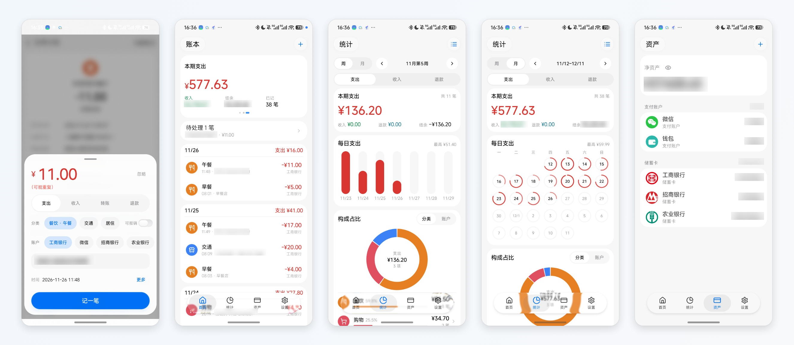
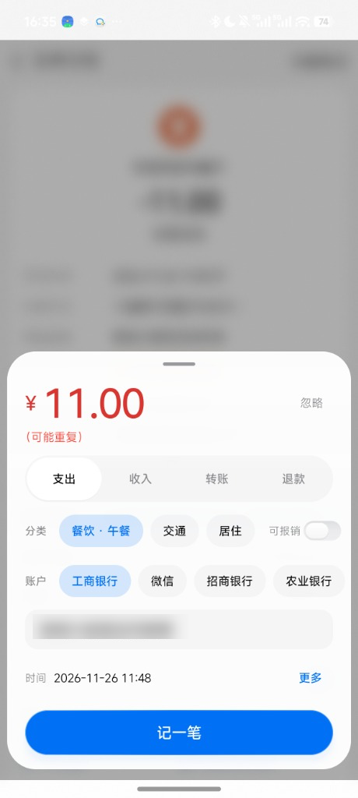
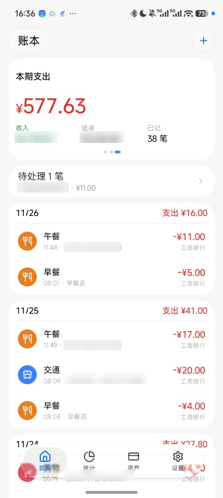
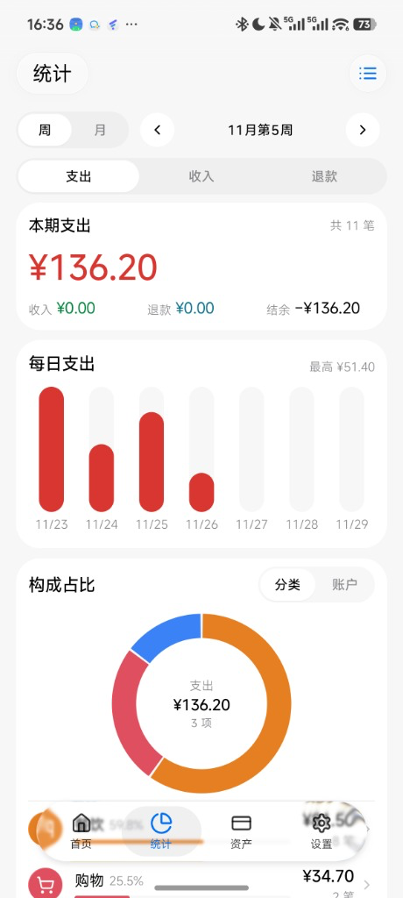
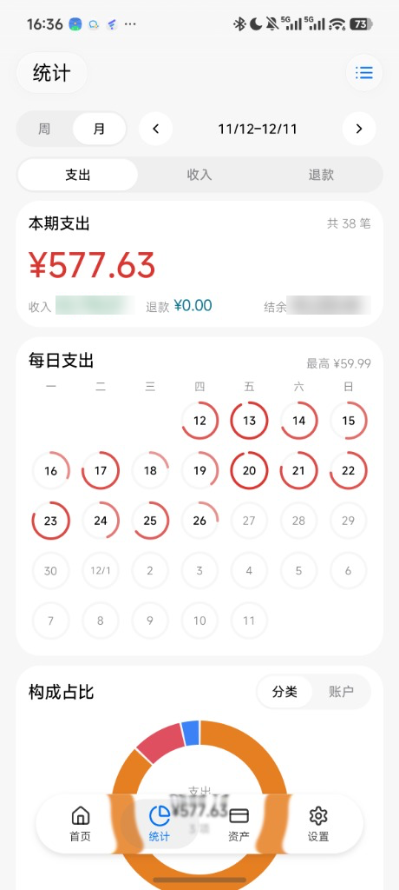
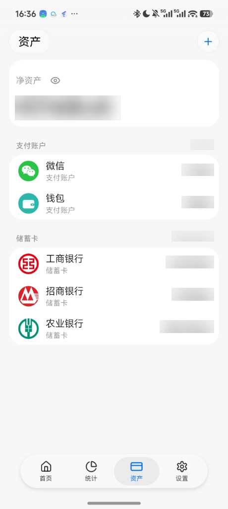

<div align="center">


# 麦米 My Money

**半自动识别微信与支付宝交易 · 纯本地存储与离线处理**

[](https://github.com/Caozl9021/MyMoney/releases)
-3DDC84)
[](LICENSE)

[下载安装包](https://github.com/Caozl9021/MyMoney/releases) · [更新日志](CHANGELOG.md) · [安全与隐私边界](SECURITY.md) · [参与贡献](CONTRIBUTING.md)

</div>

---

> 最新正式版：**`1.11.4 / 167`**（[Release `v1.11.4`](https://github.com/Caozl9021/MyMoney/releases/tag/v1.11.4)）  
> 从旧版升级请使用**同签名 Release APK** 直接覆盖安装，本机账单与设置会自动保留。

---

## 界面预览

<p align="center">
  
</p>

<details>
<summary>查看单页高清截图</summary>

| 确认卡 | 账本首页 | 统计（周） | 统计（月） | 资产 |
| :---: | :---: | :---: | :---: | :---: |
|  |  |  |  |  |

</details>

---

## 半自动记账

支付完成后本地自动提取金额、商户与支付方式并弹出确认卡，自动匹配分类、账户、餐段与备注；**只有你点「记一笔」才会入账**。

```text
微信 / 支付宝交易
   ├── 通知监听（主力，不依赖无障碍）
   ├── 页面识别（打开交易详情页自动提取）
   └── 可选增强（本地 V6 OCR 补空字段 / Root 读通知 / LSPosed 交易凭证）
          │
          ▼
本地规则匹配 + 智能填充 + 重复检查
          │
          ▼
弹出确认卡（关闭自动弹卡时暂存「待确认」）──► 点「记一笔」入账并联动资产余额
```

可在 **设置 → 自动记账** 中独立开关识别能力：

| 方式 | 触发时机与说明 | 权限 / 条件 | 默认状态 |
| :--- | :--- | :--- | :--- |
| **通知监听** | 收到支持的微信 / 支付宝交易通知即识别 | 通知使用权 | 推荐日常开启 |
| **页面识别** | 打开交易详情页自动采集（付款成功页仍由通知负责） | 无障碍服务 | 按需开启 |
| **页面文字补全** | 详情节点缺商户、支付方式或商品名时用离线 OCR 补全 | Android 11+ (64位) | **默认关闭**，需主动同意 |
| **高级增强** | Root 读通知备用 / LSPosed 交易凭证增强 | Root / LSPosed | 可选，见 [LSP 上手](docs/LSP_QUICKSTART.md) |

- **去重与防误覆**：两路共用去重与确认卡；重复打开已记账或已忽略的同一笔交易时，若账本存在疑似记录，仅在金额下方提示 **`（可能重复）`**，是否保留由你决定。你在确认卡中手改的字段不会被后续识别覆盖。
- **本地越用越顺手**：内置 Rhino 本地规则引擎，支持按时间段自动填充餐饮餐段、备注快捷建议与本地分类学习。详见 [本地规则说明](docs/LOCAL_RULES.md) · [OCR 说明](docs/OCR_ASSISTANCE.md)。

---

## 纯本地数据与隐私边界

- **100% 本地识别与学习**：不使用云端识图或第三方 AI；离线 OCR 原图仅在内存短期处理，不落盘、不进备份。
- **不触碰第三方私有数据**：不扫描微信 / 支付宝私有数据库，不拦截支付流程。
- **关闭系统云备份**：`allowBackup` 默认关闭，防止账本被手机厂商云盘静默上传。
- **`INTERNET` 权限仅用于两项可控操作**：
  1. 你主动点击检查 GitHub Release 更新（不上传账单或支付内容）；
  2. **可选的**自建个人云备份与 Web 看板（仅发往你自己部署的服务器；不配置则全程纯单机运行）。
- **自由导入导出**：支持 **本地 JSON 全量备份/恢复**、**钱迹 XLSX 导入** 与 **批量导出到 iCost**。

更多安全约束见 [安全策略](SECURITY.md)。

---

## 核心功能

- **桌面即记 & 小组件**：极速记账（点击直达半透明速记弹窗）、7 日支出柱状图、资产 & 报销看板、`2×1` 月支出卡片。
- **账本与统计**：自定义账期起始日与首页三点滑动切期；支持 **周 ↔ 月** 平滑切换、收支/退款占比圆环与分类/账户下钻明细。
- **资产与报销**：账户余额随记账/转账事务联动；支持标记可报销账单并统一跟踪待报销；删除账单保留只读删除日志。
- **细节体验**：麦穗品牌与 4 套主题色；Android 13+ 支持液态玻璃折射与分区域通透度调节（可一键关闭）。

---

## 可选：自建个人云备份与 Web 看板

如果你想把本机快照、实时增量同步与浏览器财务看板部署到自己的设备（NAS / 家用服务器 / VPS）上，仓库内自带了前端 [`web`](web) 与单二进制服务端 [`server-rs`](server-rs)（支持通过局域网或 Tailscale 等内网方式访问，管理台与连接码机制详见 [连接码速查](docs/CONNECT_CODE_QUICKSTART.md)）：

**前置准备**：PostgreSQL 数据库 + Rust 工具链 + Node.js（用于先打包前端静态资源嵌入服务端）。

1. **构建前端并编译服务端单二进制**：
   ```bash
   cd web && npm ci && npm run build
   cd ../server-rs && cargo build --release --locked
   # 产物位于 server-rs/target/release/mymoney-home
   ```
2. **准备配置文件与数据库**：
   复制 [`.env.example`](deploy/home-sync/.env.example) 为 `.env`，填写 PostgreSQL 连接串（`MYMONEY_DATABASE_URL`）、备份目录（`MYMONEY_BACKUP_DIR`）、管理密码（`MYMONEY_ADMIN_TOKEN`）以及手机可访问的 `MYMONEY_SERVER_URL`。
3. **初始化表结构并启动服务**：
   ```bash
   ./target/release/mymoney-home migrate --env-file /path/to/.env
   ./target/release/mymoney-home serve --env-file /path/to/.env
   ```
4. **手机配对**：
   浏览器打开 `http://<你的服务地址>/admin/cloud-backup`，用 `MYMONEY_ADMIN_TOKEN` 解锁后生成 `MMJOIN2` 连接码（或二维码），在 App 的 **设置 → 迁移与备份 → 云备份** 中扫码或粘贴连接即可。

> 若仅需单机备份，直接在 **设置 → 迁移与备份 → 本地备份文件** 中导出/导入 JSON 即可，无需部署服务端。

---

## 快速安装与构建

- **直接使用**：到 [GitHub Releases](https://github.com/Caozl9021/MyMoney/releases) 下载 `arm64-v8a` 正式签名包（要求 Android 8.0 / API 26+）。安装后开启 **通知监听**（并按需开启 **页面识别**）即可使用。

<details>
<summary>开发者：模块结构与本地构建命令</summary>

| 模块 | 作用 |
| :--- | :--- |
| [`:app`](app) | Compose 主应用、采集调度、确认卡、账本/资产/统计、桌面小组件、内置 LSPosed |
| [`:billkit`](billkit) | 纯 Kotlin 解析层：通知/页面解析、Rhino 本地规则引擎、分类/餐段策略 |
| [`:ocr-v6`](ocr-research/v6) | 固定离线原生 OCR 引擎（V6 Tiny） |
| [`server-rs`](server-rs) / [`web`](web) | 可选自建个人云备份服务端（Rust）与 Web 管理看板 |

环境：JDK 17 · Android SDK 35 · Gradle 8.14 · Kotlin 2.0.21

```bash
./gradlew :app:testDebugUnitTest :billkit:testDebugUnitTest
./gradlew :app:assembleDebug :app:assembleRelease :app:assembleDebugAndroidTest
./build-all.sh
```

详见 [架构说明](ARCHITECTURE.md) · [测试环境](docs/TEST_ENVIRONMENT.md) · [打包说明](docs/PACKAGING.md)。

</details>

---

## 许可与致谢

本项目采用 [GPL-3.0](LICENSE) 开源（完整声明见 [NOTICE](NOTICE)），产品思路受 [AutoAccounting](https://github.com/AutoAccountingOrg/AutoAccounting) 启发。

<details>
<summary>第三方组件与商标声明</summary>

| 组件 | 许可 | 用途 |
| :--- | :--- | :--- |
| [Mozilla Rhino](https://github.com/mozilla/rhino) | MPL-2.0 | 本地执行识别规则 |
| [AndroidLiquidGlassView](https://github.com/QmDeve/AndroidLiquidGlassView) | MIT | 液体玻璃折射（见 [LIQUIDGLASS-SOURCE.md](app/libs/LIQUIDGLASS-SOURCE.md)） |
| [Lucide](https://github.com/lucide-icons/lucide) | ISC | 底部导航栏动态图标 |
| AndroidX / Jetpack Compose / Material 3 / Room | Apache-2.0 | UI 与本地数据库 |
| Material Symbols | Apache-2.0 | 分类与功能图标 |

微信、支付宝分别是腾讯与蚂蚁集团的商标；钱迹、iCost 为其各自所有者的商标。本项目为独立开源工具，与上述公司无关联。

</details>

<div align="center"><sub>识别在本机执行 · 数据完全属于你自己 · Made with ♥ for 只想安静记好账的人</sub></div>
