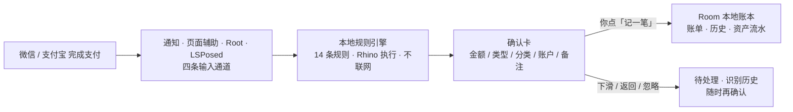
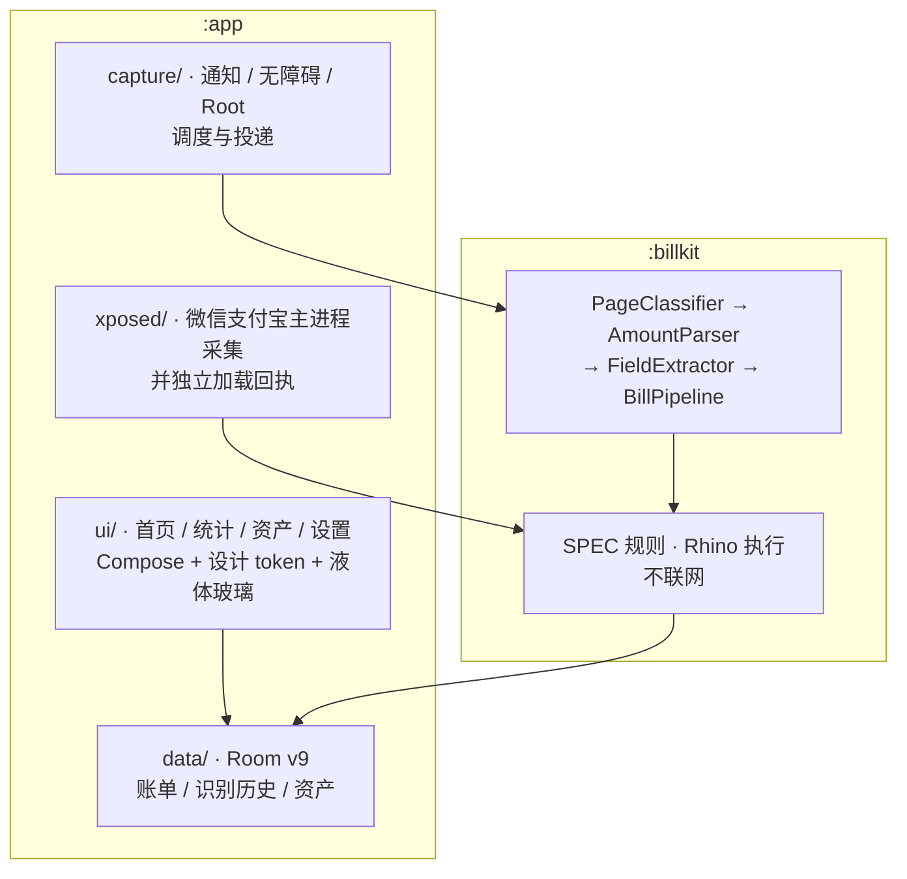

<div align="center">


# 麦米 My Money

**在微信、支付宝付完款的那一刻，账单已经替你记好了。**

本地优先的 Android 自动记账 · 规则识别 · 你点确认才入账

<sub>My Money — a local-first auto bookkeeping app for WeChat Pay &amp; Alipay</sub>

[](#快速开始)
[](#项目结构)
[](#项目结构)

[](#数据与隐私)

</div>


<div align="center"><sub>账本 · 确认卡 · 统计 · 资产：App 实际运行截图，示例为测试账本数据</sub></div>

---

## 一次支付，只要三步



**不猜、不替你做主。** 识别结果一律先成草稿，金额、类型、分类、账户都可以当场改；只有你点了「记一笔」，数据才会写进账本。

---

## 界面

<table>
  <tr>
    <td width="50%" align="center"><br/><sub><b>账本</b> · 账期摘要 + 按自然日倒序的日卡</sub></td>
    <td width="50%" align="center"><br/><sub><b>确认卡</b> · 悬浮在支付页上方，改完即记</sub></td>
  </tr>
  <tr>
    <td align="center"><br/><sub><b>统计</b> · 周柱状图与跨月热力图</sub></td>
    <td align="center"><br/><sub><b>资产</b> · 账户余额、总资产与负债</sub></td>
  </tr>
  <tr>
    <td align="center"><br/><sub><b>外观</b> · 三款主题图标、深浅色、字号、降低动效</sub></td>
    <td align="center">
      &nbsp;
      &nbsp;
      <br/>
      <sub><b>应用图标</b> · 青绿 / 蓝白 / 红金，与主题同步</sub>
    </td>
  </tr>
</table>

---

## 能力一览

| | 能力 | 说明 |
|---|---|---|
| 🎯 | **微信 / 支付宝识别** | 只做这两家。通知识别、页面辅助、Root 通知、LSPosed 交易凭证四条通道，全部收敛到同一套本地规则 |
| 🧾 | **确认卡** | 悬浮窗优先、Activity 兜底；金额、收支类型、分类、账户、备注、时间一次改完；下滑或返回会保留草稿到「待处理」，不会丢 |
| 📒 | **账本** | 账期起始日可设 1–31 号，首页摘要与日卡同步翻期；全库搜索 + 日期 / 分类 / 类型组合筛选；逐笔编辑、删除与 5 秒撤销 |
| 📊 | **统计** | 周 / 月切换，每日支出柱状图与跨月热力图；分类占比与账户汇总；转账不计收支，结余 = 收入 − 支出 + 退款 |
| 💰 | **资产** | 总资产 / 总负债、单个账户余额与按账期的非本金转账流水；账户可归档，历史导入不重复扣减 |
| 🧠 | **本地规则与学习** | 分类、账户、备注各有独立来源；人工修改与接受推荐会在本机学习，可逐条查看与删除，关掉开关即停止 |
| 🔄 | **导入导出** | 钱迹 XLSX 导入（支出 / 收入 / 完整转账）、iCost CSV 导出（含退款时阻止整次导出）、JSON 完整备份与恢复 |
| 🎨 | **外观** | 青绿 / 蓝白 / 红金三款主题与图标、浅色 / 深色 / 跟随系统、三档字号、降低动效、可关的预测性返回、随主题调整的液体玻璃顶栏与底栏 |

---

## 识别范围

只启用 **14 条原创规则**（`maimi-rules-4`，全部启用）：

| 渠道 | 页面 / 凭证规则 | 通知规则 | 转账 |
|---|---|---|---|
| 微信 | 红包支出、红包收入、支出、收入、退款 | 支出、收入 | 支出、收入 |
| 支付宝 | 支出、收入、退款 | 支出、收入 | — |

- 输入通道：**通知识别**、**页面辅助（无障碍）**、**Root 通知**、**LSPosed 交易凭证**。Root 与无障碍互斥，首次选择即保存，暂停不清模式。
- 红包金额按同一红包单号关联经过核验的回执，缺金额、串单或冲突一律拒绝，不用群总额凑数。
- 银行短信与其他 App 渠道不在本分支范围：权限、receiver 与入口均已移除，旧配置原值只做兼容，不会越界生效。

---

## 项目结构



| 模块 | 职责 |
|---|---|
| `:billkit` | 识别核心：`BillKit` 接收 `UiSnapshot`，节流去重、分类、金额解析、字段抽取、规则执行与诊断 |
| `:app` | Compose 界面与宿主、采集通道、确认卡投递、Room 账本、备份与导入导出、LSP 内核（内置主 APK） |
| 构建 | JDK 17 · Gradle 8.14 · AGP 8.7 · Kotlin 2.0.21 · `minSdk 26` / `targetSdk 35` |

---

## 快速开始

```bash
source ~/opt/mymoney-env.sh                    # JDK 17 + Android SDK
./gradlew :billkit:testDebugUnitTest :app:testDebugUnitTest
./gradlew :app:assembleDebug :app:assembleRelease
```

```bash
# 安装已核验的正式包（同一个 release 签名）
adb -s <设备序列号> install -r dist/MyMoney-0.34.0-self-release.apk
```

- 依赖缓存完整时才加 `--offline`；`local.properties` 的 `sdk.dir` 随机器调整。
- release 签名从仓库外的 `~/.mymoney-keys/keystore.properties` 读取；缺失时产物为 unsigned，不可当正式包交付。
- debug 与 release 签名不同，不能互相覆盖；覆盖升级请勿卸载，避免丢数据。

---

## 数据与隐私

- **不声明 `INTERNET` 权限。** 规则、账单、学习与备份全部在本机处理，没有云端账号、没有云端学习。
- 不读写第三方 App 的私有数据库，不 Hook 微信 / 支付宝的 Flutter / Dart 层，不做截图 OCR，不恢复任何"两路同时采集"的旧方案。
- 金额一律以 **分（Long）** 存储；账单、识别历史、资产流水保留各自身份与关联，重复提交幂等。
- 备份是 **JSON v8**，含账单、历史、账户余额与流水、采集配置、导入身份、账期与备注，兼容 v1–v7；系统 `allowBackup` 关闭，数据只走你自己导出与恢复的文件。
- 诊断样本与截图先脱敏再导出；分享给第三方 App（如 iCost）是否入账由对方与你自己确认。

---

<details>
<summary><b>已知问题与边界</b>（点开）</summary>

- **BUG-ALIPAY-DELAYED-CONFIRM-001**：支付宝停留超过 10 秒或切到桌面 / 其他 App 后才显示确认卡，具体原因待原始采集时间线确认。
- **BUG-BACK-GHOST-001**：预测性返回的残影问题，默认关闭该特性保留。
- 权限状态偶发不同步（`BUG-PERM-STALE-STATE-001`），以系统实际授权与运行状态为准。
- 各厂商的省电策略、后台清理与通知折叠可能影响采集时延；本项目不承诺固定弹框时延，也不承诺外部 App 的导入结果。
- 完整 TalkBack、低 API 设备、锁屏与长时间功耗等矩阵仍属未覆盖范围。

</details>

<details>
<summary><b>打包产物命名</b>（点开）</summary>

`dist/MyMoney-<版本>-<分支>-<debug|release>.apk`，分支标签由 `build-all.sh` 自动写入，`self` 与 `master` 同版本号不会互相覆盖。安装包不入库。

> **0.34.0 起全面改名：包名 `com.example.mymoney`，数据库 `mymoney.db`，偏好文件 `mymoney`，备份 `kind=MyMoneyBackup`，通知渠道 `mymoney_*`，深链 `mymoney://`，签名配置 `~/.mymoney-keys/keystore.properties`。**
> 系统会把它当成一个新 App：旧包可以继续共存，但两边的账单、账户与配置互不相通。设备侧还需要重新给新包名勾选 LSPosed 作用域、重建 Root 授权。

</details>

---

<div align="center"><sub>规则、账单与学习都留在你自己的手机里 · Made with ♥ for 只想记好账的人</sub></div>
