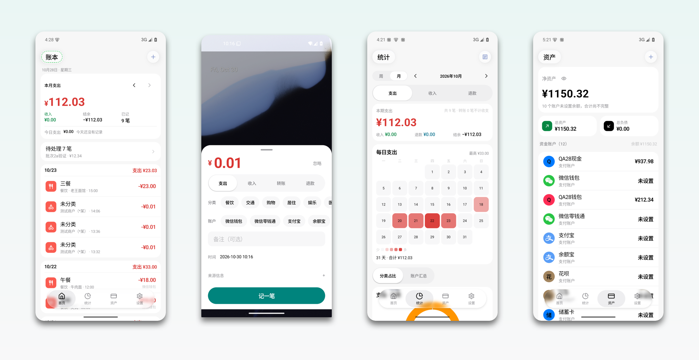

<div align="center">


# 麦米 My Money

本地识别微信、支付宝交易，核对后由你确认记账。

**1.9.0 / 143 候选 · 待用户验收**

[下载发布附件](../../releases) · [文档](docs/README.md) · [当前范围](docs/PROJECT_SCOPE.md) · [待验收清单](docs/ACCEPTANCE.md)
</div>



图片为历史测试账本界面示例，不作为143布局或真实支付覆盖的证明。当前包从[候选导航](dist/latest-app.json)定位，本地候选不表示已发布到GitHub。

## 两种基础识别方式

| 方式 | 怎么用 |
| --- | --- |
| 通知监听 | 收到支持的微信/支付宝交易通知后识别，不依赖无障碍 |
| 页面识别 | 开启后打开交易详情即可自动识别；付款成功页由通知监听负责，不从页面生成草稿 |
| 页面文字补全 | 可选OCR，默认关闭并需同意；为可靠的详情节点草稿补商户、支付方式或商品等空字段 |

两种方式独立开关/授权/状态，位于设置→自动记账→识别方式与增强。总开关统一暂停，关闭自动弹卡时结果进入待确认。没有合格通知时，付款成功页允许不弹；页面识别并非手动按钮，也不承诺所有付款都有通知。

Root读通知是通知的内部备用实现，listener优先；LSPosed交易凭证为高级可选增强。两者不恢复旧Root页面轮询，不改变仅微信/支付宝的应用范围。

识别一律先形成待确认，只有你点“记一笔”才入账。同笔两路共用去重和确认卡，已记账/忽略及人工字段受保护。疑似重复在金额下方仅显示“（可能重复）”，保存或忽略由你决定；同一识别重复保存仍幂等。

## 账本和迁移

- 首页按账期汇总，分类/账户统计可下钻到统一账单详情；资产与转账按原子事务联动。
- 删除先确认，记录历史保存只读删除日志，不提供恢复或5秒撤销。
- 钱迹XLSX导入、设置内iCost批量导出、完整JSON备份及可选家庭规则同步/手动快照备份。单笔iCost分享已移除。
- 首页加号直接手动记账；选图入口为设置→迁移与备份→导入账单→从截图补记，公共确认卡不再提供用截图补充。
- Room10，JSON9兼容1–8；原始截图不进备份或家庭同步。规则同步使用独立rule-sync.db，不是逐笔账单双向同步。

## 规则与OCR边界

规则包源码当前1.3.0、15条规则、生成标记maimi-rules-5；App和规则包独立版本/发布。官方包升级保留个人规则与状态。规则只处理宿主已经准入的输入，不能绕过详情场景或通知门禁。见[规则说明](docs/LOCAL_RULES.md)。

固定离线OCR引擎为V6 Tiny，需API30+与64位进程；主App仍支持minSdk26。Q1字段补充已实现，Q0真实样本/ARM64预算仍有缺口，Q2缺金额时生成第一份草稿未实现。整页空节点盲截不在范围。见[OCR说明](docs/OCR_ASSISTANCE.md)。

## 构建

JDK17、Android SDK35，Gradle wrapper8.14、AGP8.7、Kotlin2.0.21。

```bash
./gradlew :app:testDebugUnitTest :billkit:testDebugUnitTest
./gradlew :app:assembleDebug :app:assembleRelease :app:assembleDebugAndroidTest
./build-all.sh
```

本机SDK在local.properties配置，release签名从仓库外读取；未签名包不作为正式交付。debug与release不同签名，覆盖升级使用同签名APK，不卸载规避。产物进入dist/app/<version>-<code>/<run-id>；规则另放dist/rules，发布快照和候选分开，详见[部署](DEPLOYMENT.md)与[打包](docs/PACKAGING.md)。

| 模块 | 作用 |
| --- | --- |
| :app | Compose宿主、采集协调、确认/账本/备份、内置LSP |
| :billkit | 原生页面/通知解析、交易规则与纯策略 |
| :ocr-v6 | 固定离线原生引擎 |
| :ocr-fixture | 可选隔离测试页面，不进生产包 |

[架构](ARCHITECTURE.md) · [贡献约定](CONTRIBUTING.md) · [测试环境](docs/TEST_ENVIRONMENT.md)

## 数据与验证

识别和学习在本机执行。App声明INTERNET，用于主动GitHub更新和用户配置的家庭同步/备份；不会向GitHub上传支付内容。家庭快照只发送到所配置的家庭服务，原图不上传；不扫描第三方私有数据库或自动点击支付。详见[安全边界](SECURITY.md)。

143已有1092JVM、三构建、strict35和默认Waydroid间距证据；G阶段两个包名的合成页面各11项自动事件/OCR/卡片验证，不能当真实微信/支付宝付款。真实G9、完整ROM/API/ARM64/可访问性及Release UI未完成，候选仍待验收。遗留延迟弹卡、权限状态、预测返回残影不因本版直接关闭，见[剩余计划](docs/PLAN_1.0.md)。

<details>
<summary><b>第三方组件与许可</b>（点开）</summary>

本项目以 [GPL-3.0](LICENSE) 发布。完整声明见 [NOTICE](NOTICE)。

| 组件 | 许可 | 用途 |
| --- | --- | --- |
| [Mozilla Rhino](https://github.com/mozilla/rhino) | MPL-2.0 | 在设备上执行本地识别规则，无原生 `.so` |
| [AndroidLiquidGlassView](https://github.com/QmDeve/AndroidLiquidGlassView) | MIT | 顶栏与底栏的液体玻璃折射效果；本地 AAR 的来源与改动见 [说明](app/libs/LIQUIDGLASS-SOURCE.md) |
| [Lucide](https://github.com/lucide-icons/lucide) | ISC | 底部 dock 的动态图标路径，已适配 Compose |
| AndroidX / Jetpack Compose / Material 3 | Apache-2.0 | UI 工具链、生命周期、Room |
| Material Symbols | Apache-2.0 | 应用内的分类图标 |

**商标**：微信、支付宝分别是腾讯控股有限公司与蚂蚁集团股份有限公司的商标；iCost（钱迹）为其各自所有者的商标。本项目是独立的非官方工具，与上述公司无关联、未获其背书或赞助。

</details>

---

## 致谢

本项目的产品思路受 [AutoAccounting](https://github.com/AutoAccountingOrg/AutoAccounting) 启发：它证明了「支付后自动记账」可以做成真正能日常使用的工具，本项目在形态与交互上从中受益。

---

## 参与贡献

欢迎 Issue 与 PR。提交前请先读 [CONTRIBUTING.md](CONTRIBUTING.md)——里面写了代码约定、如何新增一条识别规则，以及**报告问题前如何脱敏诊断样本**。

发现安全问题请走 [SECURITY.md](SECURITY.md) 里的私密渠道，不要开公开 Issue。

---

<div align="center"><sub>规则、账单与学习都留在你自己的手机里 · Made with ♥ for 只想记好账的人</sub></div>

打包产物按版本、构建号和独立运行目录存放，位置见 `dist/latest-app.json`；详细规则见 [打包文件存放规则](docs/PACKAGING.md)。
